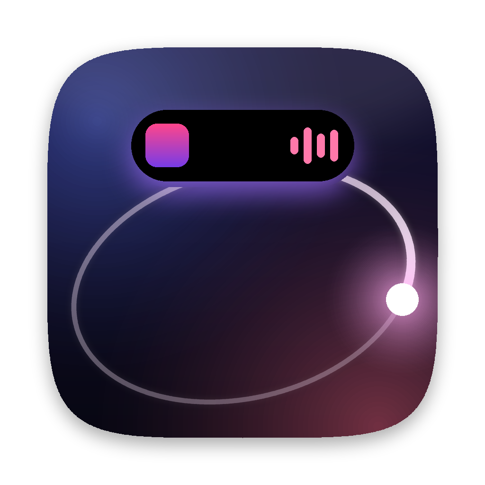
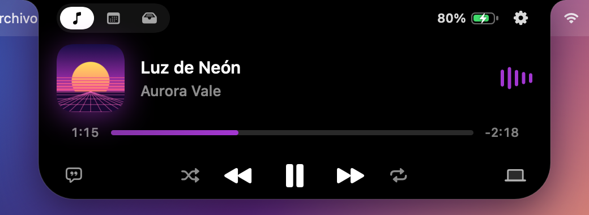
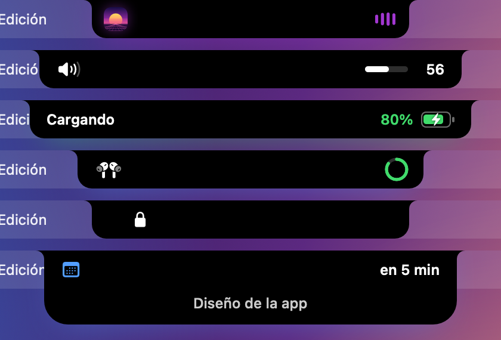
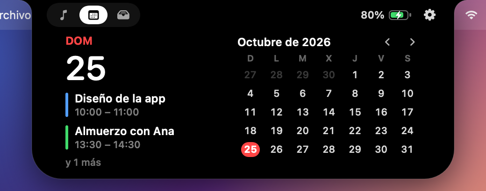
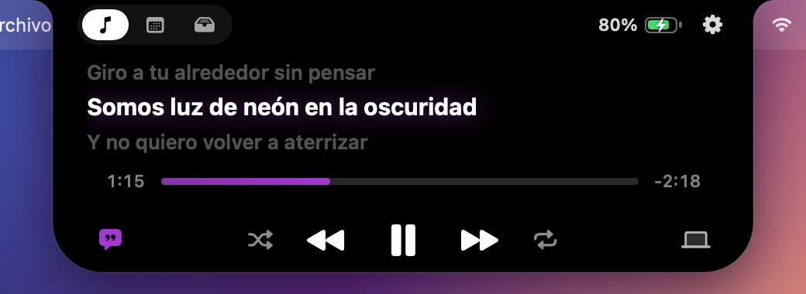
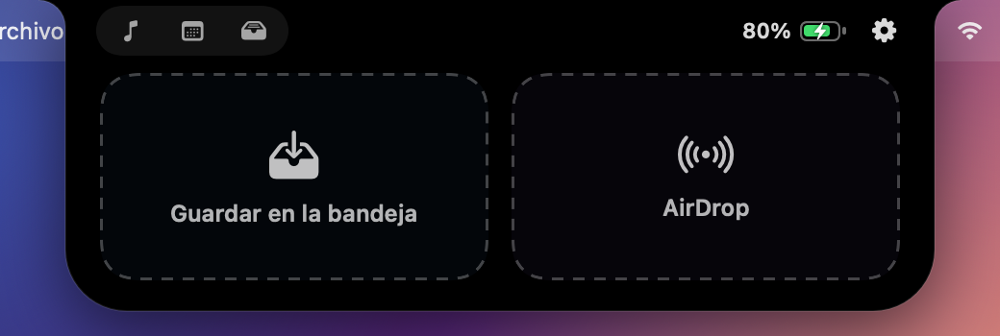
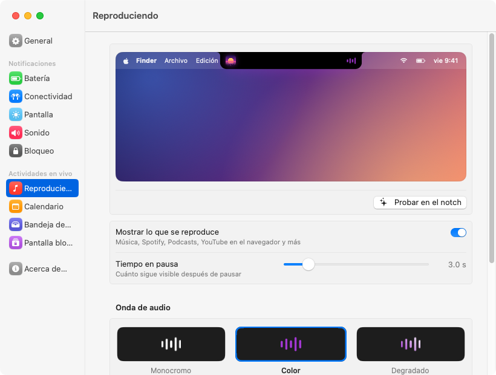

<p align="center">
  
</p>

<h1 align="center">Orbit</h1>

<p align="center"><b>Tu notch, vivo.</b><br>
Música, avisos, calendario y archivos en el notch de tu Mac, con animaciones fluidas que parecen de Apple.</p>

<p align="center">
  <a href="../../releases/latest"><b>⬇︎ Descargar Orbit para Mac</b></a>
</p>

<p align="center">
  
</p>

---

## Qué hace

- **Reproduciendo** — la portada a la izquierda del notch y una onda de audio a la derecha. Pasa el cursor y se abre con título, artista, progreso (puedes arrastrarlo), controles y la salida de audio. La portada gira en 3D al cambiar de canción y la isla brilla con sus colores.
- **Letras sincronizadas** — la letra avanza línea por línea, en la isla y en la pantalla bloqueada.
- **Avisos** — cargador conectado, batería baja, carga completa, AirPods y otros dispositivos Bluetooth (con su batería), volumen y brillo, bloqueo y desbloqueo.
- **Calendario** — el día de hoy, tus eventos y el mes completo. Te avisa unos minutos antes de cada evento.
- **Bandeja de archivos** — arrastra archivos al notch para guardarlos y sácalos cuando los necesites. También puedes soltarlos en la zona de AirDrop.
- **Pantalla bloqueada** — un reproductor con portada, controles y letras sin desbloquear tu Mac.
- **Todos los Mac** — usa el notch real en los MacBook que lo tienen, y una isla virtual (notch o flotante) en Mac sin notch y monitores externos.

<p align="center">
  
</p>

<p align="center">
  
  
</p>

<p align="center">
  
  
</p>

## Animación única

Orbit tiene su propio estilo de movimiento, **Órbita**:

- la isla se estira como un líquido: el ancho llega antes que el alto y rebota suavemente;
- cuando llega algo nuevo, **dos destellos de luz recorren el borde** de la isla y se encuentran abajo en un pulso del color del aviso;
- el contenido aparece en cascada, saliendo de un desenfoque;
- al pasar el cursor, la isla "respira" y el trackpad da un toque háptico.

También puedes elegir los estilos **Suave** o **Rápida** y ajustar la velocidad.

## Personalización

En **Ajustes de Orbit** (icono de la barra de menús, clic derecho en el notch o el engranaje de la isla abierta) puedes cambiarlo todo, con una vista previa animada en cada sección:

General · Batería · Conectividad · Pantalla · Sonido · Bloqueo · Reproduciendo · Calendario · Bandeja de archivos · Pantalla bloqueada

<p align="center">
  
</p>

## Instalar

1. Descarga **Orbit.dmg** desde [Versiones](../../releases/latest).
2. Ábrelo y arrastra **Orbit** a **Aplicaciones**.
3. La primera vez, macOS dirá que no puede comprobar el desarrollador (Orbit no está firmado con una cuenta de pago de Apple). Abre **Ajustes del Sistema → Privacidad y seguridad**, baja hasta el final y pulsa **Abrir igualmente**.

   O en Terminal: `xattr -dr com.apple.quarantine /Applications/Orbit.app`

Requiere **macOS 14 Sonoma** o posterior. Funciona en Mac con Apple Silicon e Intel.

### Permisos (todos opcionales)

| Permiso | Para qué |
|---|---|
| Bluetooth | Mostrar cuándo se conectan tus AirPods y su batería |
| Calendarios | Ver tus eventos en el notch |
| Accesibilidad | Reemplazar el indicador de volumen y brillo de macOS |

## Compilar desde el código

```bash
# 1. Adaptador de música
git clone https://github.com/ungive/mediaremote-adapter.git vendor/mra
cmake -S vendor/mra -B vendor/mra/build && cmake --build vendor/mra/build
mkdir -p vendor/adapter
ditto vendor/mra/build/MediaRemoteAdapter.framework vendor/adapter/MediaRemoteAdapter.framework
cp vendor/mra/bin/mediaremote-adapter.pl vendor/adapter/

# 2. App
./scripts/build-app.sh   # crea build/Orbit.app y build/Orbit.dmg
```

`Orbit --snapshot carpeta` dibuja cada estado de la isla en PNG, útil para revisar el diseño.

## Créditos

- [mediaremote-adapter](https://github.com/ungive/mediaremote-adapter) (BSD-3) para leer lo que se reproduce en macOS 15.4 y posteriores.
- [LRCLIB](https://lrclib.net) para las letras sincronizadas.

## Licencia

MIT © 2026 Heber Gomez
